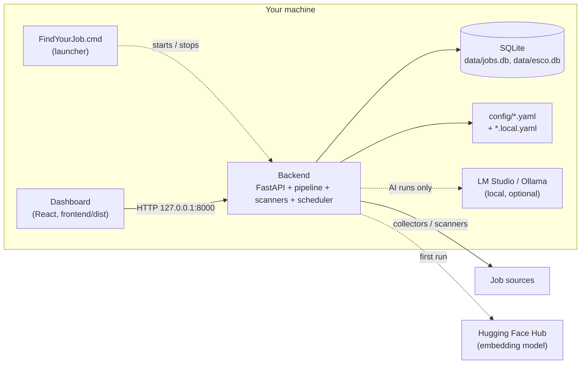

# Find Your Job With AI

> A local-first job discovery and ranking app. Finds relevant jobs, not just more jobs.

[](https://www.python.org/)
[](LICENSE)
[](tests/)

Job boards show the same listings to everyone and bury the few that fit. **Find Your
Job With AI** collects listings from a dozen sources, rejects the ones that cannot fit
your profile (location, contract, seniority, stated education and experience), ranks
the rest with an auditable, deterministic score refined by local sentence embeddings and
your feedback, and shows the result in a local web dashboard. Every decision — accepted
or rejected — is recorded with its evidence, so you can see *why* a job was ranked or
dropped.

Your profile, feedback and job data stay in a SQLite database on your machine. No paid
cloud AI is used. The optional LLM stages target a model running on your own machine
(LM Studio or Ollama).

**Who it is for:** one person who is comfortable editing a YAML file and running a
Python project, and wants a job-search tool they fully control. It is a single-user,
single-machine app, developed and used on Windows 11 — not a hosted service, and it has
no login.

---

## Contents

- [Status](#status) · [Quick start (Windows)](#quick-start-windows) ·
  [Other ways to run it](#other-ways-to-run-it)
- [Architecture](#architecture) · [Privacy and network behaviour](#privacy-and-network-behaviour) ·
  [Data and backups](#data-and-backups)
- [Configuration](#configuration) · [Local AI](#local-ai)
- [Development](#development) · [Security](#security) · [Limitations](#known-limitations)

Deeper material: [technical reference](docs/reference.md) (pipeline stages, scoring,
collectors, API, database) · [architecture](docs/architecture.md) (decision journal,
feedback, evaluation, lab) · [ADRs](docs/adr/README.md) · [Windows app](docs/windows-app.md) · [Windows installer](docs/windows-installer.md) ·
[development guide](docs/development.md) · [contributing](CONTRIBUTING.md).

---

## Status

| Area | Status |
|---|---|
| Deterministic pipeline: collect → normalize → validate → deduplicate → filter → requirements gate → score → store | ✅ default-on |
| Semantic matching (local sentence embeddings) | ✅ default-on |
| Feedback-driven personalization: dashboard feedback re-ranks later runs (never changes accept/reject) | ✅ implemented, **off by default** — opt in with `personalization_bridge: true` in `config/feedback.yaml` ([ADR 0009](docs/adr/0009-feedback-journal.md)) |
| Decision journal: an auditable record per job and run, accepted and rejected ([ADR 0008](docs/adr/0008-decision-journal.md)) | ✅ default-on |
| Web dashboard (FastAPI + React): runs, jobs, explanations, review queue, stats, profile editor | ✅ |
| Windows launcher: one entry point that starts, monitors and stops the app ([docs](docs/windows-app.md)) | ✅ new — Windows only |
| LinkedIn / HelloWork background scanners with pause/resume | ✅ opt-in; daily once chosen, stop on a 429 and resume after a cooldown |
| Background scheduler (recurring scans/runs) | ✅ config-gated |
| Feedback journal, disagreement/abstention review queue ([ADR 0009](docs/adr/0009-feedback-journal.md), [0010](docs/adr/0010-disagreement-and-abstention.md)) | ✅ |
| Local-LLM enrichment and LLM eligibility gate | ✅ implemented, **off by default** |
| Evaluation harness (labelled datasets, metrics, comparisons; [ADR 0007](docs/adr/0007-evaluation-harness-outside-production-path.md)) | 🧪 developer tooling, outside the production path |
| Experiment lab with human-approved promotion ([ADR 0011](docs/adr/0011-experiment-lab.md)) | 🧪 experimental; the lab agent is OS-isolated only when you run it in its sandbox (`python -m src.lab sandbox`, Windows AppContainer) |
| Greenhouse, Lever, SmartRecruiters, WorkingNomads collectors | ⚙️ implemented, no source configured |
| macOS / Linux | ⚠️ backend, CLI and tests run (CI is Linux); the launcher and startup scripts are Windows-only |
| Docker | ⚠️ the image runs the CLI pipeline only, not the web UI |
| Windows installer: per-user, bundled Python, desktop + Start Menu shortcuts ([docs](docs/windows-installer.md)) | ✅ 1.0.0, not code-signed |

---

## Quick start (Windows)

**Easiest: the installer.** Download `FindYourJobWithAI-Setup-<version>.exe` and its `.sha256`
from the [latest release](https://github.com/ItackFPS/Find-Your-Job-With-AI-Public/releases/latest),
check the hash (`Get-FileHash .\FindYourJobWithAI-Setup-<version>.exe` in PowerShell), run it,
then double-click **Find Your Job With AI** on the desktop. No Python, Node.js or Git needed, no administrator
rights; nothing is collected until you start a run. Install, first run, sources and
credentials, stopping, logs, upgrades and uninstalling: [docs/windows-installer.md](docs/windows-installer.md).
To build the installer yourself: `powershell -ExecutionPolicy Bypass -File packaging\windows\build.ps1`
(same page, "Building the installer").

The rest of this section runs the app from a source checkout instead.

### Prerequisites

| Needed | Version | For |
|---|---|---|
| Windows 10/11 | — | the launcher (`FindYourJob.cmd`) |
| Python | 3.12 (the version CI tests) | backend and pipeline |
| Node.js | 22 LTS (20.19+ works) | building the dashboard once, and after updates |
| Git | any | getting and updating the code |
| ~1.5 GB disk | — | Python packages (~300 MB, no PyTorch), the embedding model (~470 MB), your database |

Optional: [LM Studio](https://lmstudio.ai) or [Ollama](https://ollama.com) for the AI
stages. A GPU is not needed.

### Install

```bat
git clone https://github.com/ItackFPS/Find-Your-Job-With-AI-Public.git
cd Find-Your-Job-With-AI-Public
py -3.12 -m venv .venv
.venv\Scripts\python -m pip install -e .
cd frontend && npm ci && npm run build && cd ..
copy .env.example .env
```

#### Daily search in the background

Once you have saved your profile (the **Profile** page), the backend runs the search once a
day on its own (`pipeline_daily` in `config/schedules.yaml`), from 08:00 your local time: it
collects the official and public sources, then filters and scores the offers. If the computer
was off at that time, it runs as soon as the app starts; after several days off, it runs once,
not once per missed day. The time stays the same across the clock change. The time and an
on/off switch for all background runs are in `data/settings.json`
(`"background": {"enabled": true, "daily_time": "08:00"}`, also `GET/PUT /api/settings/background`). It waits while a LinkedIn or
HelloWork scan is running, and a finished scan starts it. A search you start yourself with
**Run pipeline** counts as the day's search once it completes. Before you save a profile, nothing
is collected on its own. To turn off only the daily search, set `startup_policy: disabled` on
`pipeline_daily` and restart the backend; **Run pipeline** on the dashboard still works.

#### Job scans (LinkedIn, HelloWork)

The shipped config has two background scanners, **off until you choose them**: on a fresh
install, starting the backend collects nothing. A scan starts when you press **Scan now** on
its dashboard card (and can be paused there): LinkedIn through `python-jobspy`, HelloWork by
fetching its job pages (about 30 minutes, one request per job). Once you have run a source, or
chosen it in `data/settings.json` (`"unofficial_sources": {"linkedin": true}`), it also scans
once a day in the background. If the site answers "too many requests" (HTTP 429), the scan
stops at once, waits (1 h, then 2 h, … up to 24 h) and resumes from where it stopped, slowly
at first. They send search queries built from
your profile, so fill in the **Profile** page first — see
[Privacy and network behaviour](#privacy-and-network-behaviour). The LinkedIn scanner
needs the optional extra (`.venv\Scripts\python -m pip install -e ".[linkedin]"`);
without it, its scan fails with an install message and everything else works.

To change this, edit these files, then restart the backend:

| You want | Setting |
|---|---|
| A daily scan only for the sources you chose (shipped default) | `config/schedules.yaml`: `startup_policy: when_opted_in` |
| A scan at every start, then once per UTC day, chosen or not | same entries: `startup_policy: run_once_per_day` |
| Manual scans only | same entries: `startup_policy: disabled` |
| Never scan a source in the background | `data/settings.json`: `"unofficial_sources": {"linkedin": false}` (or `"hellowork"`) |
| LinkedIn off entirely (no automatic or manual scan) | `config/linkedin.yaml`: `enabled: false` |
| HelloWork off entirely (no automatic or manual scan) | `config/sources.yaml`: delete the `- name: hellowork` entry (its `active: false` only keeps it out of pipeline runs; it does not stop the scanner) |

The schedule settings are re-read from `config/schedules.yaml` at every start; the file
wins over anything stored in the database.

Then:

1. **Your profile.** Start the app and fill in the **Profile** page — it saves to
   `config/profile.local.yaml` (git-ignored). The tracked `config/profile.yaml` is only
   an example.
2. **Secrets, only for what you use** — in `.env`: France Travail API credentials (the
   one source that needs them). Everything is optional;
   see [Configuration](#configuration). Without France Travail credentials each run
   skips that source and says so in the run's errors (status DEGRADED); credentials
   that are set but rejected stop the run until they are fixed. To silence the
   warning, set `active: false` on `france-travail` in `config/sources.yaml`.

### Run

Double-click **`FindYourJob.cmd`**. It checks the installation, rebuilds the dashboard
if needed, starts the backend on `127.0.0.1` at a free port and opens the dashboard. Press
**Ctrl+C** or close the window to stop everything it started. A second launch opens the
running instance; a backend the launcher did not start (for example the logon task) is never
connected to: it does not know this instance's token.

```bat
FindYourJob.cmd status        :: what is running, who owns it
FindYourJob.cmd stop          :: stop a running launcher from another window
FindYourJob.cmd shortcut      :: add a Start menu shortcut
FindYourJob.cmd --help
```

Trigger a pipeline run from the dashboard and watch its progress live. The first run
downloads the embedding model once. See [docs/windows-app.md](docs/windows-app.md) for
every option, logs, the logon tasks, updating and uninstalling, and troubleshooting.

### Update

Stop the app, then `git pull`; reinstall Python packages if `pyproject.toml` changed
(`.venv\Scripts\python -m pip install -e .`) and run `cd frontend && npm ci` if
`frontend/package-lock.json` changed. The launcher rebuilds the dashboard by itself.
The database schema is upgraded in place at startup (idempotent column additions); back
up `data/` first — see [Data and backups](#data-and-backups).

---

## Other ways to run it

```bash
# Backend + built dashboard, any OS (http://127.0.0.1:8000)
uvicorn src.api.app:app --host 127.0.0.1 --port 8000

# Development: Vite dev server with hot reload (http://127.0.0.1:5173), backend as above
cd frontend && npm run dev          # or, on Windows: FindYourJob.cmd dev

# CLI: one pipeline run, summary in the terminal
python src/main.py                  # deterministic pipeline
python src/main.py --ai             # + local-LLM stages (needs LM Studio/Ollama)

# Docker: CLI pipeline only
docker compose up --build
```

Do not run the backend with `--reload` unattended: a reload restarts the process and
abandons a scan or pipeline run in progress (see `src/api/app.py`'s docstring).

---

## Architecture



The pipeline (`src/pipeline/orchestrator.py`) is the same whether it runs from the CLI
(`src/main.py`) or the dashboard (`src/api/runner.py`):

```text
discovery → collection → normalization → validation → deduplication → hard filtering
→ requirements gate (+ optional LLM eligibility gate) → deterministic scoring → storage
→ (optional) local-LLM enrichment → semantic matching → personalization → dashboard
```

The job's stored score is the deterministic score, saved right after scoring; semantic
matching and personalization produce a per-run ranking recorded separately and never
overwrite it ([ADR 0002](docs/adr/0002-stored-score-is-deterministic.md)). Filtering, the
requirements gate and scoring are rule-based and reproducible; AI stages can only
enrich, never decide eligibility on their own
([ADR 0001](docs/adr/0001-deterministic-gates-before-optional-ai.md)). Details:
[docs/reference.md](docs/reference.md) and [docs/architecture.md](docs/architecture.md).

| Component | Required | Managed by |
|---|---|---|
| Backend + dashboard | yes | the launcher, a logon task (`scripts/install_startup.py`), or you |
| SQLite databases | yes | the backend (created and upgraded in place) |
| Embedding model | yes | its ONNX export, downloaded from Hugging Face on first use |
| LM Studio / Ollama | only for AI-enabled runs | you; the launcher only reports its state |

---

## Privacy and network behaviour

What is verified in the code (not a promise of offline operation — collecting jobs needs
the internet):

| Outbound connection | When | What is sent |
|---|---|---|
| Job sources — France Travail (its public occupation pages, robots.txt respected; the API when you have credentials), RemoteOK, Jobicy, We Work Remotely, Indeed (its mobile app's API), EURES; LinkedIn (via `python-jobspy`) and HelloWork scanners | pipeline runs, scheduled scans | search queries built from your profile (keywords, locations); never your profile file, feedback or database |
| Hugging Face Hub | first use of the embedding model; each later model load checks for updates unless `HF_HUB_OFFLINE=1` | model file requests (Hub telemetry is turned off) |
| `PHASE2_LLM_ENDPOINT` (default `http://localhost:1234`); `--llm-endpoint` of the evaluation/lab tools | only AI-enabled runs, or those tools when you pass the flag | job text and profile summary. It is whatever you configure — keep it local; the launcher warns if it is not (its `status` check sends only a `GET /v1/models`) |
| ESCO API (European Commission) | only when you run `scripts/setup_esco.py` | skill search terms |
| PyPI, npm registry | only when you install or update | package downloads |

Not present: no analytics, no telemetry of this project, no update checks, no account,
no paid cloud AI, and no fallback to a cloud model when the local one is down (the AI
stages fail open to the deterministic result). An LLM endpoint that is not on this machine
is refused, not used: the AI stages then run without AI and record why
(`FYJ_ALLOW_REMOTE_LLM=1` opts into a server you control elsewhere, such as a GPU box on
your network). The dashboard loads no external scripts
or fonts.

**Offline use.** Once the embedding model has been downloaded (first pipeline run) and
`HF_HUB_OFFLINE=1` is set, everything that works on stored data runs without internet:
the dashboard, job details and explanations, feedback, the review queue, the profile
editor, evaluation replays, and AI stages against a local LLM. Collecting jobs needs the
internet — a run without it finds no new jobs (each source fails on its own without
stopping the run) — and so does `scripts/setup_esco.py`.

**What stays local:** your profile (`config/profile.local.yaml`), feedback, decisions,
embeddings and every collected job (`data/`), logs (`logs/`) and secrets (`.env`). All of
these are git-ignored.

**Exposure:** the backend listens on `127.0.0.1` only and refuses foreign `Host` headers
and cross-site writes, but it has **no login**: any program running on this computer can
use it. Set `API_SAME_USER_ONLY=1` to serve only your Windows account's processes. Never
expose port 8000 to a network. See [SECURITY.md](SECURITY.md).

---

## Data and backups

| Path | Content | Back it up? |
|---|---|---|
| `data/jobs.db` (+ `-wal`, `-shm`) | jobs, runs, scores, decisions, feedback, caches, staging tables | yes — the one file that matters |
| `data/esco.db` | ESCO skill taxonomy (re-creatable) | optional |
| `data/benchmarks/`, `data/lab/`, `data/lab.db` | evaluation datasets and lab state, if you use them | if you use them |
| `config/*.local.yaml`, `.env` | your profile, secrets | yes, privately |
| `logs/` | application, launcher and scanner logs | no |
| `%USERPROFILE%\.cache\huggingface` | the embedding model | no (re-downloadable) |

SQLite runs in WAL mode: **stop the app before copying `data/jobs.db`**, or copy
`jobs.db`, `jobs.db-wal` and `jobs.db-shm` together, or use
`sqlite3 data/jobs.db ".backup backup.db"`. The schema is upgraded in place at startup
by idempotent `ALTER TABLE ... ADD COLUMN` steps and one-time named migrations; there
is no down-migration, so keep a backup before updating. Tests always use temporary
databases and fail if they touch `data/` or `config/`.

---

## Configuration

All tunables are YAML files in `config/`; secrets are environment variables in `.env`.

**Personal values never go in tracked files.** `config/profile.yaml` is a neutral
default; `config/profile.local.yaml` (git-ignored) replaces it entirely when present. The
Profile page writes it for you.

| File | Purpose |
|---|---|
| `config/profile.yaml` | example profile: domains, skills, ordered location preferences, work modes, contracts, seniority/experience bounds, education ceiling, gate toggles |
| `config/sources.yaml` | which collectors are active and their settings |
| `config/filters.yaml` · `config/scoring.yaml` | hard filters; scoring weights and gates |
| `config/semantic_config.yaml` · `config/personalization.yaml` | embedding model and blend weight; feedback adjustment bounds |
| `config/linkedin.yaml` · `config/schedules.yaml` | LinkedIn scanner; scheduler definitions |
| `config/decisions.yaml` · `config/feedback.yaml` · `config/disagreement.yaml` · `config/retention.yaml` | decision journal, feedback, review-queue rules, history retention |

`scoring.yaml`, `filters.yaml`, `semantic_config.yaml` and `personalization.yaml` feed
the strategy fingerprint used by the evaluation harness; changes to them are strategy
changes ([ADR 0011](docs/adr/0011-experiment-lab.md)).

### Environment variables (`.env`)

Copy `.env.example` to `.env`; every variable is optional.

| Variable(s) | For |
|---|---|
| `FRANCE_TRAVAIL_CLIENT_ID` / `FRANCE_TRAVAIL_CLIENT_SECRET` | the France Travail collector ([developer.francetravail.fr](https://developer.francetravail.fr), scope `o2dsoffre api_offresdemploiv2`) |
| `PHASE2_LLM_PROVIDER`, `PHASE2_LLM_ENDPOINT`, `PHASE2_LLM_MODEL_NAME`, … | local LLM, see [Local AI](#local-ai) |
| `API_ALLOWED_HOSTS` | extra `Host` names the backend accepts (e.g. `host.docker.internal`) |
| `API_SAME_USER_ONLY` | `1` serves only processes of the account running the backend |
| `FYJ_PORT` | fixed backend port for the launcher (default: a free port chosen at each start; `dev` mode: 8000) |
| `HF_HUB_OFFLINE` | `1` once the model is cached: no Hugging Face requests at all |

`AI_ENABLED`, `AI_MODEL`, `DATABASE_URL` and `LOG_LEVEL` in older `.env` files are
legacy and not read by the code: the AI stages are switched on per run, the database
is always `data/jobs.db`, and logging is configured in `src/logging_config.py`. Never
commit `.env`.

---

## Local AI

Three AI components, deliberately separated from the deterministic pipeline:

| Component | Default | What it does |
|---|---|---|
| Sentence embeddings (`paraphrase-multilingual-MiniLM-L12-v2`, CPU) | on | similarity between each job and your profile, blended with a small weight (0.06) |
| Local-LLM enrichment (`src/ai/`) | off | structured understanding of the top-ranked jobs, feeding semantic matching |
| LLM eligibility gate (`src/ai/eligibility.py`) | off | flags implicit requirement mismatches; fail-open, never rejects on its own failure |

The LLM stages call an OpenAI-compatible `POST /v1/chat/completions` endpoint: LM Studio
(`http://localhost:1234`, uses the loaded model) or Ollama (`http://localhost:11434`,
model must match a pulled tag). They run only when a run asks for them — **AI Understanding** in
the dashboard, `--ai` on the CLI, `"use_ai": true` in the API — and the eligibility gate
additionally needs `matching.llm_eligibility_enabled: true` in your profile. Start the
LLM server yourself; nothing downloads or starts a model for you. Results are cached per
job content and profile version.

```ini
PHASE2_LLM_PROVIDER=lmstudio          # or ollama
PHASE2_LLM_ENDPOINT=http://localhost:1234
PHASE2_LLM_MODEL_NAME=local-model
PHASE2_LLM_TIMEOUT_SECONDS=60
PHASE2_MAX_WORKERS=4                  # your server's parallel slots
PHASE2_MAX_CANDIDATES=100             # only the top-N ranked jobs are analysed
```

---

## Development

```bash
pip install -e ".[dev,mcp_admin]"
pytest -m "not network"          # what CI runs (~5,000 tests, 10–15 min)
ruff check src tests             # advisory, baseline in docs/baselines/
mypy src                         # advisory
cd frontend && npm ci && npm run lint && npx tsc -b && npm test
```

Tests use temporary databases and configs; an autouse guard fails any test that writes
to the real `data/` or `config/` (stop a running backend before the full suite). Tests
marked `network` reach live sites and never run in CI. Workflow, branch and commit rules,
and how to run every CI check locally: [CONTRIBUTING.md](CONTRIBUTING.md) and
[docs/development.md](docs/development.md). Coding agents follow [CLAUDE.md](CLAUDE.md)
(also referenced by [AGENTS.md](AGENTS.md)).

---

## Security

Report vulnerabilities privately — see [SECURITY.md](SECURITY.md). Do not open a public
issue for a security problem.

---

## Known limitations

- Accuracy on real offers is not measured. Every published figure comes from a 50-job
  synthetic benchmark; ranking quality is `not_measured` (no graded relevance labels).
- The Windows installer is not code-signed: SmartScreen warns about an unknown publisher.
  Check the published SHA-256 before running it.
- Single user, no login; never expose the backend to a network.
- Windows is the supported desktop platform; the launcher and logon tasks are
  Windows-only.
- Some collectors use unofficial endpoints or scraping (Indeed's mobile API, LinkedIn via
  `python-jobspy`, HelloWork pages). Sites change, block automated access, or forbid it
  in their terms: check each site's terms before enabling a source.
- APEC and Welcome to the Jungle were removed in 2.0: their bot protection (a CAPTCHA,
  a firewall) blocks automated requests, and the app never tries to get round it. Offers
  they collected before stay in your history. A `config/sources.yaml` from 1.x that still
  lists `apec` or `wttj` is skipped with that reason on each run; delete those entries.
- Several registered collectors have no configured source.
- The Docker image runs the CLI pipeline only.
- The lab agent is OS-isolated only when it runs in the lab sandbox (Windows AppContainer:
  `python -m src.lab sandbox grant --apply`, then `sandbox run -- …`; see
  [docs/development.md](docs/development.md#sandboxed-lab-agent-windows-appcontainer-no-administrator)).
  Started any other way, only an in-process guard keeps it away from your data. Treat lab
  output as untrusted either way ([ADR 0011](docs/adr/0011-experiment-lab.md)).
- `ruff` and `mypy` run in CI as advisory checks against documented baselines.

---

## License

MIT — see [LICENSE](LICENSE). Vendored agent skills under `.agents/skills/` keep their
own licence notices.
